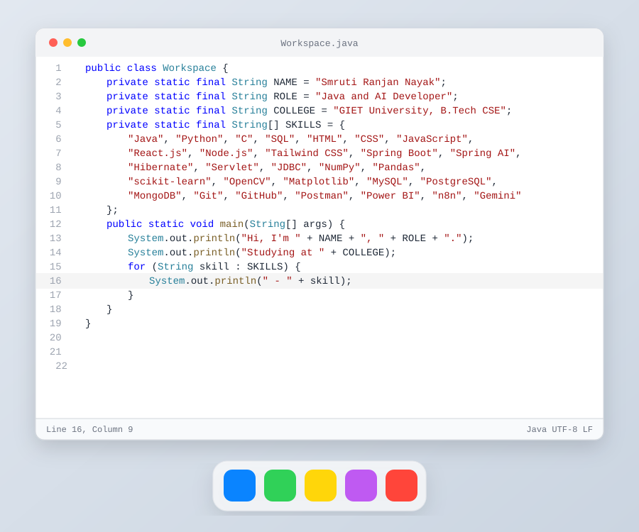

<picture>
  <source media="(prefers-color-scheme: dark)" srcset="workspace-dark.svg">
  
</picture>

  

# Hi, I'm Smruti Ranjan Nayak

Third-year B.Tech CSE student at GIET University. I build Java backends and AI tools, mostly with Spring Boot, retrieval-augmented generation and workflow automation.

 

-59666C?style=flat-square&logo=hibernate&logoColor=white)

 

## Projects

| Project | What it does |
|---|---|
| [Recall](https://github.com/Recursive-Rhino/Recall) | Document question answering with RAG. Spring Boot, Spring AI and Google Gemini, with PostgreSQL and PgVector for semantic search |
| [Email Reply Extension for Chrome](https://github.com/Recursive-Rhino/Email-Reply-Extension-For-Chrome) | A Chrome extension that reads the Gmail thread you are replying to and inserts an AI-written reply from a Spring Boot backend |
| [AI Deep Research Automation](https://github.com/Recursive-Rhino/AI-deep-research-automation) | An n8n workflow that researches a topic on the web in several rounds and writes the report into Notion |
| [MoneyManager](https://github.com/Recursive-Rhino/MoneyManager_Project) | A finance tracker in Spring Boot with JWT login, BCrypt password hashing and email verification |

## Experience and certifications

- AI/ML Intern at CTTC, Bhubaneswar (June to July 2025). Built a face recognition attendance system in Python and OpenCV with about 95% accuracy.
- Networking Virtual Intern at EduSkills, supported by Zscaler (January to March 2026).
- Certified by Oracle University in AI Foundations and in Agentic AI Foundations, and by RapidMiner in data engineering.

## Find me

| | |
|---|---|
| LinkedIn | [linkedin.com/in/smruti-ranjan-nayak-](https://linkedin.com/in/smruti-ranjan-nayak-) |
| GitHub | [github.com/Recursive-Rhino](https://github.com/Recursive-Rhino) |
| Email | [smrutiranjan2965@gmail.com](mailto:smrutiranjan2965@gmail.com) |
